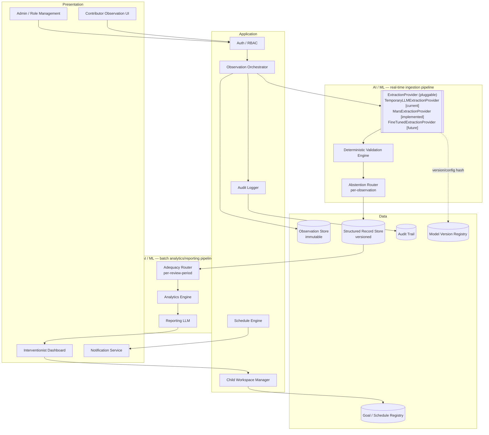

# High-Level Design: Interventionist AI System

## Problem

Parents, teachers, and intervention staff generate useful natural-language observations about a child's progress toward autism intervention goals, but those observations are heterogeneous, unstructured, and hard to review longitudinally against interventionist-defined criteria. Without structure, interventionists cannot reliably answer questions like "is this child on track for this goal across settings?" without re-reading every raw note by hand.

The system exists to close that loop without displacing the interventionist as decision-maker: it is not intended to diagnose autism, prescribe treatment, or autonomously change intervention goals.

## Approach

The system implements a closed loop:

**Interventionist-defined goal → goal-aware observation collection → raw observation preservation → structured extraction → deterministic validation → longitudinal analytics → goal-attainment trajectory → evidence-grounded explanation → interventionist review.**

Two load-bearing disciplines make this loop trustworthy rather than merely automated:

- **Pluggable, swappable extraction.** All structured extraction goes through an `ExtractionProvider` contract. A temporary general-purpose LLM (`TemporaryLLMExtractionProvider`) implements it today; a future fine-tuned foundation model (`FineTunedExtractionProvider`) will implement it later, returning the identical `ExtractionResult` shape. No backend API, persistence, validation, abstention, analytics, reporting, or frontend code depends on which provider is active.
- **Deterministic authority over model output.** The extraction provider proposes; it never has final authority. A deterministic validation engine checks every extracted field against explicit rules (evidence support, taxonomy membership, count consistency) before anything is persisted, and an adequacy/abstention router withholds analytics and flags human review rather than forcing a conclusion from thin evidence.

A secure, role/child/goal-scoped retrieval layer ("Secure RAG") is the intended mechanism for supplying the extraction and observation-guidance steps with the right permitted context (active goal, approved taxonomy, prior authorized history) — see [Secure Retrieval Layer (Planned)](#secure-retrieval-layer-planned) below. It is a planned enhancement to *how the current extraction provider is given context*, not a second extraction pipeline.

## Target Users

- **Interventionist** — owns goal definitions and attainment criteria, reviews AI-structured evidence and analytics, makes all clinical/programmatic decisions. Needs trustworthy, evidence-traceable longitudinal views without doing manual chart review.
- **Parent/Caregiver** — contributes observations from home/community settings through a conversational interface. Needs a low-friction way to report what happened without learning a structured form or seeing clinical scoring.
- **Teacher** — contributes observations from educational settings under the same conversational model as caregivers, scoped to the children and goals they're authorized for.
- **Admin** — manages organization/tenant setup, users, roles, and child-level authorization; does not participate in observation content.

## Goals

- Every structured field presented to an interventionist traces back to a specific span of contributor-submitted raw text.
- Contributors can submit a natural-language observation and receive focused clarification questions when key information is ambiguous, without ever seeing structured fields, confidence scores, or analytics.
- Analytics and trajectory estimates are computed by deterministic code from validated structured records — never asserted directly by an LLM.
- Adequacy checks cause the system to abstain (withhold a conclusion) rather than present a low-confidence or evidence-thin analytic result as settled.
- The extraction provider can be swapped (temporary LLM → fine-tuned model) with zero changes to any consuming layer.
- Child-level authorization is enforced at both the UI and API layers, with negative-path tests proving cross-child access is impossible.

## Non-Goals

- Diagnosing autism, prescribing treatment, or autonomously modifying interventionist-defined goals.
- Training or fine-tuning the final foundation extraction model during the current phase (deferred — see [Current Phase Boundary](#current-phase-boundary)).
- Treating LLM-generated structured output — from either provider — as expert gold-standard ground truth.
- Presenting a trend projection as a validated clinical prediction before validation data supports that claim.
- Unrestricted retrieval/search across all children or organizations; retrieval (current or planned RAG) is always authorization-scoped first.
- Building a general-purpose clinical chatbot; the conversational surface exists only to collect and clarify goal-relevant observations.

## Tenets

- **Deterministic code is the final authority over model output, always.** When a rule and a model disagree, the rule wins and the record routes to review — never the reverse.
- **Abstain over assert.** When evidence is inadequate for a conclusion, withholding the analytic is preferred to producing a plausible-looking but unsupported one.
- **Contract stability over implementation convenience.** The `ExtractionProvider` contract is treated as fixed API surface; a provider swap must never leak into consuming layers, even if that means a slightly less convenient provider-side implementation.
- **A model may rank what code computed; it may never author what reaches an interventionist.** Where model judgment improves a choice among candidates, it selects; the candidates and the selection arithmetic stay in deterministic code.
- **Minimize before you retrieve.** Any retrieval layer (current permission checks, future RAG) is scoped down (org → child → goal → role) before content reaches a model, not filtered after the fact.

## System Design

### Current architecture (implemented)



The ingestion pipeline (`ExtractionProvider → Validation Engine → Abstention Router`) and the batch pipeline (`Adequacy Router → Analytics Engine → Reporting LLM`) are two separate arrow segments, not one linear chain: the ingestion pipeline runs per observation as it's submitted; the batch pipeline runs per review period over many already-persisted records. Their only connection is that the batch pipeline reads what ingestion has written to `RecStore`. See `docs/lld/Abstention_Router.md` and `docs/lld/Adequacy_Router.md` for the full split — the two are easy to conflate from their names alone.

Every arrow into `RecStore` passes through `Val` — there is no path from an extraction provider to persistence that skips deterministic validation.

`MarsExtractionProvider` (implemented — see `docs/lld/Mars_Reranking.md`) occupies the `EP` position rather than adding a stage: it *implements* the provider protocol while composing several providers behind it, generating multiple candidate extractions and using multiple LLM judges to rank them. Judges emit only an ordering over opaque candidate labels, and the winner is selected by deterministic rank fusion, so no field value originates with a judge and the returned record is one a candidate provider produced. Everything downstream of `EP` is unchanged.

### Secure Retrieval Layer (planned)

The handoff research design (`CLAUDE_PROJECT_HANDOFF.md`) specifies a role/child/goal-scoped retrieval layer sitting in front of both the observation-guidance conversation and the extraction step, so that context supplied to a model is always pre-filtered by authorization rather than filtered after retrieval:

```mermaid
flowchart LR
    Req[Request: org, user, role,\npermitted child(ren), active goal] --> AuthFilter{{Authorization filter\napplied BEFORE retrieval}}
    AuthFilter --> Index[(Pseudonymized Retrieval Index\nchild_id, goal_id, doc_type, embedding)]
    Index --> Context[Permitted context only]
    Context --> EP2[ExtractionProvider / Guidance LLM]
    AuthLayer[(Authoritative Data Store\nencrypted raw + structured records)] -. never embedded directly .-> Index
```

This is additive to the current architecture: it changes *what context the `ExtractionProvider` and observation-guidance LLM receive*, not the extraction contract, validation, analytics, or reporting layers downstream. It has not been implemented; per [§24 of the handoff](../CLAUDE_PROJECT_HANDOFF.md#24-current-project-decision), the bottleneck is data/schema/ground-truth design, not additional AI components, so this layer is sequenced after the schema and annotation protocol are finalized.

### Current Phase Boundary

The current development phase builds the full application and CHAT-transcript processing pipeline against the temporary LLM provider. CHAT processing (parsing, deidentification, episode segmentation, segment selection, provisional structured extraction) is in scope now; its LLM-generated records are provisional, not expert gold-standard labels. Expert-adjudicated gold-standard finalization, foundation-model fine-tuning (LoRA/QLoRA), baseline comparison, and frozen held-out research evaluation are deferred until the data/annotation methodology in the handoff (schema → annotation protocol → ground truth → leakage-safe split) is resolved.

## Key Design Decisions

| Decision | Alternatives Considered | Rationale |
|---|---|---|
| Extraction goes through a pluggable `ExtractionProvider` protocol rather than calling an LLM vendor directly from business logic | Direct vendor SDK calls in services; a single hard-coded extraction function | Lets the future fine-tuned model replace the temporary LLM with zero changes to APIs, persistence, validation, abstention, analytics, reporting, or frontend — the swap is a config/registry change, not a rewrite |
| Deterministic validation sits between the extraction provider and persistence, not after | Trust provider confidence scores; validate asynchronously post-write | Raw LLM output must never be stored directly; validating pre-write guarantees the record store only ever holds rule-checked structured data |
| Analytics and trajectory estimates are computed entirely in deterministic code, never asserted by an LLM | Let the reporting LLM compute or summarize trend numbers directly | An LLM restating or deriving a number risks an unsupported or fabricated figure reaching an interventionist as if it were computed; code-computed analytics are auditable and reproducible |
| Multi-model extraction is composed *behind* the `ExtractionProvider` protocol (MARS), with LLM judges restricted to ranking opaque candidate labels and the winner chosen by deterministic rank fusion | A multi-model orchestration layer above the provider, called from business logic; an LLM aggregator that reads judge output and picks a winner; judges that emit a corrected extraction | Composing behind the existing protocol keeps every consuming layer unchanged, and confining judges to orderings makes the "no LLM-authored value reaches persistence" guarantee checkable by construction rather than by prompt discipline — a judge that emits a value is just another extractor |
| Abstention is a first-class output state, not an error path | Always emit best-effort analytics with a confidence caveat | A caveated-but-present number still gets read as a conclusion; withholding it entirely forces the interventionist to recognize evidence is inadequate |
| Secure RAG is deferred behind schema/annotation/ground-truth finalization (handoff §24) rather than built alongside the current pipeline | Build retrieval-augmented context now, alongside the temporary-LLM pipeline | Per the handoff's explicit sequencing decision, adding retrieval before the target schema and annotation protocol are settled would optimize context delivery for a extraction target that is still moving |
| Original observation text is never updated or deleted after extraction; corrections create new structured-record versions | Overwrite the structured record in place on correction | Every AI-derived field must remain traceable to source evidence indefinitely, including after a correction supersedes it |

## Success Metrics

- **Unsupported extraction rate** — fraction of extracted fields not supported by any span in the source observation text; should trend toward zero and is treated as a safety metric, not just an accuracy metric.
- **Field-level precision/recall/F1** and **exact structured-record match** against expert-annotated ground truth, once the annotation protocol (handoff §11) produces labels.
- **Abstention correctness** — rate at which the adequacy router withholds analytics when evidence is genuinely inadequate, vs. false abstains that withhold when evidence was sufficient.
- **Cross-child/cross-tenant access denial rate** — negative-path authorization tests must show 100% denial for unauthorized child/goal access at both UI and API layers.
- **Provider-swap regression** — when `FineTunedExtractionProvider` ships, the full backend/frontend test suite must pass unchanged against it, proving the contract held.

**Falsification signals:** if a structured field is ever traced to no source text, if analytics are computed anywhere outside the deterministic Analytics Engine, if a correction ever overwrites rather than versions a record, or if swapping providers requires touching a consuming layer — the design has failed its own decisions above.

## References

- `docs/lld/Extraction_Provider.md`, `docs/lld/Deterministic_Validation_Engine.md`, `docs/lld/Abstention_Router.md`, `docs/lld/Adequacy_Router.md`, `docs/lld/Analytics_Engine.md`, `docs/lld/Reporting_Llm.md`, `docs/lld/Secure_Retrieval_Layer.md`, `docs/lld/Foundation_Model_Fine_Tuning.md`, `docs/lld/Goal_Attainment_Forecasting.md`, `docs/lld/Mars_Reranking.md` — component-level LLDs for the AI/ML layer.
- `CLAUDE_PROJECT_HANDOFF.md` — Secure RAG longitudinal autism intervention support research handoff (source for the planned retrieval layer, extraction training dataset design, and RQ1–RQ5).
- `CLAUDE.md` — current-phase directives, 4-layer architecture, coding conventions, and safety rules.
- `docs/BRD.docx`, `docs/Technical_Specification_Autism_AI_System.docx` — business requirements and technical specification.
- `docs/System_Verification_and_Validation_Report.md`, `docs/RESEARCH_DEMO_GUIDE.md`, `docs/User_and_Demo_Manual.md` — verification, demo, and usage documentation for the implemented system.
- `src/backend/ml/extraction/base.py` — `ExtractionProvider` protocol as currently implemented.
- JMIR AI Autism Longitudinal Intervention Draft V3 — Operational Workflow research paper.
