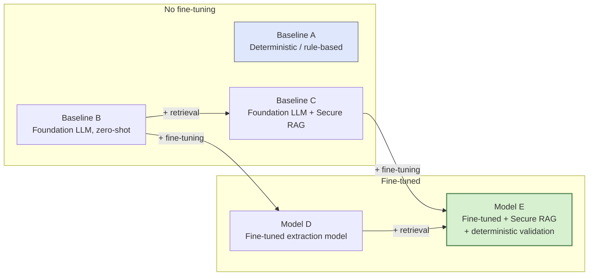

# Foundation Model Fine-Tuning (Planned)

**Status: explicitly deferred.** CLAUDE.md states plainly: "Do NOT train or fine-tune the final foundation model during this phase." This LLD exists so the deferred work has a design to implement against once the phase boundary lifts — it documents *what* the eventual training effort must produce and *why*, not a plan to start it now.

## Context and Design Philosophy

`FineTunedExtractionProvider` already exists as a stub (`src/backend/ml/extraction/finetuned_model.py`) implementing the `ExtractionProvider` protocol — `extract()` raises `NotImplementedError`, `get_info()` reports `is_available=False`. See `docs/lld/Extraction_Provider.md`. This LLD is the design for what fills that stub in.

Per handoff §10, training is not justified simply because the system contains AI — a foundation LLM + retrieval can already do baseline extraction. Training earns its place specifically for the **observation-to-structure extraction task**: repeatable, domain-specific mapping from heterogeneous caregiver/teacher/CHAT-transcript language into the project's exact schema, at a consistency and cost profile a prompted general-purpose model can't guarantee. This is explicitly *not* an attempt to train a general clinical LLM (handoff §10, §20).

The current-phase decision (handoff §24) is that **the bottleneck is data and ground-truth design, not model training** — this LLD's dataset, annotation, and splitting sections are the actual near-term work; the training/fine-tuning sections describe what those sections feed once they're resolved.

## Training Unit and Dataset Schema (handoff §11)

```text
Input  = natural-language observation + permitted goal context
Target = expert/interventionist-approved structured annotation
```

| Column | Source |
|---|---|
| `Observation_ID`, `Child_ID`, `Goal_ID`, `Observer_Role`, `Setting`, `Observation_Text` | Existing Observation Store record |
| `Domain`, `Target_Skill` | Expert label |
| `Opportunity_Count`, `Independent_Count`, `Prompted_Count`, `Prompt_Type` | Expert label |
| `Behavior/Outcome`, `Context` | Expert label |
| `Evidence_Span(s)` | Expert label — must be a literal substring of `Observation_Text` |
| `Annotation_Confidence` | Expert label |

**Ground truth source (hard constraint, handoff §11):** structured ground truth must come from trained domain annotators following a documented annotation protocol. An LLM-generated structure — from either `TemporaryLLMExtractionProvider` or a future fine-tuned model — must never be automatically treated as ground truth, including the provisional CHAT-derived structured records the current phase produces (CLAUDE.md: "LLM-generated CHAT structured records are provisional and are NOT expert gold-standard research labels").

## Data Sourcing (handoff §12)

Rollins/Flusberg CHAT corpora (11 children, 85 sessions, 75,003 utterances) are a candidate source for observation text, vocabulary, and pattern/example development — **not** an assumed source of longitudinal intervention-goal labels. Their applicability depends on the exact variables and licensing/consent conditions actually present in those datasets; this must be verified per-field before any column above is populated from them, not assumed from the corpora's existence.

Preferred pipeline (handoff §12):

```text
Existing ASD/language resources → domain vocabulary/pattern analysis
    → target schema + annotation guideline development
    → real observation text → expert annotation
    → extraction training/evaluation dataset
```

## Data Splitting (handoff §14)

**Hard constraint:** no child may appear in more than one partition. Observation-level random splitting is prohibited when a child could otherwise land in multiple partitions.

```text
70% children -> training
15% children -> validation
15% children -> held-out testing
```

No child in the held-out test set may appear anywhere in training. If temporal forecasting is evaluated (see the exploratory trajectory work in `docs/High_Level_Design.md`), the split must also prevent future information from leaking into past prediction points — a held-out test child's later sessions cannot inform a prediction made at an earlier point for a training child.

## Fine-Tuning Approach

Per CLAUDE.md's deferred-items list: LoRA/QLoRA adaptation of a foundation model, not a from-scratch model. The trained model must implement the same `ExtractionProvider` protocol as `TemporaryLLMExtractionProvider` (`docs/lld/Extraction_Provider.md`) and return an identical `ExtractionResult` — same `status` semantics, same field set, same abstention contract (explicit `null` + `abstention_reason` over a guess). This is a hard interface constraint, not a preference: CLAUDE.md requires the swap to happen "without requiring changes to backend APIs, persistence, validation, abstention, analytics, reporting, or frontend behavior."

## Evaluation Design (handoff §13)

Recommended comparison ladder — two independent axes (retrieval, fine-tuning), not a single line of increasing complexity:



`TemporaryLLMExtractionProvider` (`docs/lld/Extraction_Provider.md`) is Baseline B today. Adding `docs/lld/Secure_Retrieval_Layer.md` once it ships moves the deployed system to Baseline C without any fine-tuning. Model D/E only clear the ladder if they beat C by a margin that justifies training cost — same simpler-preferred discipline as `docs/lld/Goal_Attainment_Forecasting.md`'s model-selection rule, applied here to extraction instead of forecasting.

Metrics: field-level precision/recall/F1, exact structured-record match, evidence-span accuracy, **unsupported extraction rate**, missing-information handling, inter-annotator agreement on the human ground truth.

**Unsupported extraction rate is a safety metric, not just an accuracy metric** (handoff §13): if the source text never states a physical prompt occurred but the model outputs `prompt_type = physical`, that is an unsupported extraction and must be measured explicitly, independent of whether the rest of the record scores well on F1. The same standard applies to `TemporaryLLMExtractionProvider` today — see `docs/lld/Extraction_Provider.md`'s abstention thresholds — so Model D/E must be held to a standard already enforced in production, not a lower one.

## Decisions & Alternatives

| Decision | Chosen | Alternatives Considered | Rationale |
|---|---|---|---|
| Fine-tune vs. train from scratch | LoRA/QLoRA adaptation of an existing foundation model | Train a domain-specific model from scratch | Per CLAUDE.md/handoff §10, the task is a narrow structured-extraction mapping, not a task requiring new general-language capability — full pretraining would be disproportionate cost for the actual gap being closed |
| Ground truth provenance | Expert/interventionist annotation only | Bootstrap ground truth from `TemporaryLLMExtractionProvider`'s provisional CHAT extractions, with spot-checking | Handoff §11 explicitly forbids treating LLM output as unquestioned ground truth; bootstrapping from it would let the temporary provider's own biases and errors propagate into the label set the future model is trained and evaluated against |
| Split granularity | Child-level (70/15/15), never observation-level | Observation-level random split; session-level split | Handoff §14 — a child's observations share latent characteristics (communication style, baseline skill level); observation-level splitting would leak a child's identity/pattern across train and test, inflating apparent accuracy |
| Interface contract with the rest of the system | Fine-tuned model implements the existing `ExtractionProvider` protocol unchanged | Give the fine-tuned model a richer/different output contract (e.g., native confidence intervals, multi-span evidence graphs) and adapt downstream consumers | CLAUDE.md's explicit swap requirement — a provider-specific contract would force changes in validation/abstention/analytics/reporting, defeating the purpose of the pluggable-provider design (`docs/High_Level_Design.md` § Key Design Decisions) |
| Evaluation baseline ladder includes rule-based and zero-shot LLM baselines, not just the fine-tuned model in isolation | Full A–E comparison | Evaluate only the fine-tuned model against ground truth | Handoff §13 — without baselines, a fine-tuned model's F1 can't be judged as actually earning its training cost over a simpler approach; the HLD tenet against overselling the RAG/training distinction requires showing the delta |

## Open Questions & Future Decisions

### Deferred (blocked on current-phase work per handoff §24)
1. Base model selection — blocked on the target schema (handoff §11 columns) being finalized, since architecture/context-length needs depend on final field count and evidence-span handling.
2. Annotation protocol and inter-annotator agreement procedure — not yet drafted (handoff §22, item 4–5); this LLD's dataset schema is the target shape, not a confirmation the protocol exists.
3. Whether Rollins/Flusberg licensing/consent terms actually permit the specific columns above to be populated from that corpus, or only support vocabulary/example development (handoff §12) — must be resolved per-dataset before any training data is assembled from it.
4. Frozen held-out test-set governance (when it's frozen, who can access it, re-evaluation policy) — CLAUDE.md lists "frozen held-out research-model evaluation" as deferred; no process exists yet.
5. Whether Secure RAG (`docs/lld/Secure_Retrieval_Layer.md`) is a prerequisite for Model E's evaluation or can be evaluated on a mocked/static retrieval context — depends on which lands first.

## References

- `CLAUDE.md` — phase boundary ("Do NOT train or fine-tune the final foundation model during this phase"; deferred items list).
- `CLAUDE_PROJECT_HANDOFF.md` §10 (Why Train a Model), §11 (Proposed Extraction Training Dataset), §12 (Rollins/Flusberg Data), §13 (Extraction Experiments), §14 (Data Splitting), §24 (sequencing decision).
- `docs/lld/Extraction_Provider.md` — the `ExtractionProvider` contract and `FineTunedExtractionProvider` stub this work fills in.
- `docs/lld/Secure_Retrieval_Layer.md` — Model E's RAG dependency.
- `docs/High_Level_Design.md` § Non-Goals ("Training or fine-tuning the final foundation extraction model during the current phase"), § Current Phase Boundary.
