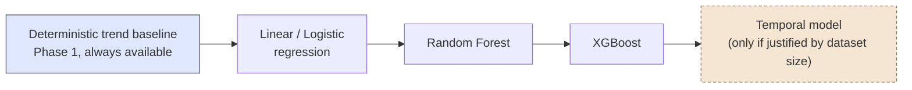

# Goal-Attainment Forecasting (Exploratory, Planned)

**Status: Phase 1 implemented** (`src/backend/ml/forecasting_engine.py`, specs in [Goal_Attainment_Forecasting_Specs.md](./Goal_Attainment_Forecasting_Specs.md)). Per `docs/High_Level_Design.md`, this is the *exploratory contribution* — do not oversell it as a validated clinical prediction model until longitudinal data actually supports that claim (handoff §17, §20). Phase 1 (deterministic) is a near-term, low-risk addition once the Analytics Engine's KPIs are in place — that gate is now cleared. **Phase 2 (ML forecasting) remains gated on dataset adequacy and is not to be built speculatively ahead of that** — no code, model, or training pipeline exists for Phase 2, and none should be added without an explicit decision on the dataset-size threshold in Open Question #1 below.

## Context and Design Philosophy

This component is downstream of the [Analytics Engine](./Analytics_Engine.md): it takes the KPIs that engine already computes deterministically (independence rate, prompt-support trend, rolling performance) and projects them forward toward the interventionist-defined `target_threshold`. It does not replace the Analytics Engine's per-KPI abstention discipline — a forecast is not computed for a KPI the Analytics Engine has already abstained on.

The load-bearing tenet from the handoff (§17, last line): **"A simpler interpretable model should be preferred if performance is comparable to a complex model."** This governs the entire Phase 1 → Phase 2 structure below — complexity is earned by demonstrated accuracy gain, not assumed from a model's sophistication.

## Phase 1 — Transparent Deterministic Trajectory

No ML model. Given a KPI's current rolling value and recent slope, project a linear crossing time against the goal's threshold:

```text
Goal threshold          = 80%
Current rolling value   = 62%
Recent slope            = +4.5 percentage points / week

Projected crossing time = (80 - 62) / 4.5 ≈ 4 weeks
```

This is presented as **a trajectory estimate conditional on the recent trend, with uncertainty and limitations stated explicitly** — never as a committed prediction date. It reuses the Analytics Engine's existing trend computation (`prompt_support_trend` / `outcome_trend` — see `docs/lld/Analytics_Engine.md`), which is itself a simple first-half-vs-second-half rate delta, not a fitted regression. Phase 1's "slope" is that same delta, not a new statistical quantity — no additional modeling machinery is introduced at this phase.

### Required Graph Elements

Per handoff §17, any chart presenting this trajectory must visually distinguish five things — this is a UI/reporting constraint, not just an analytics constraint:

```text
┌─────────────────────────────────────────────────────┐
│ Goal: Independent requesting          Threshold: 80%│
│                                                       │
│  100%┤                                    ┌╌╌╌╌╌╌╌   │ ← projected trajectory (dashed)
│      │                              ┌╌╌╌╌╌┘           │
│   80%┼─────────────────────────────┼───────────────  │ ← interventionist-defined threshold
│      │                        ●   ╱                   │
│   62%┤                    ●  ╱  ← fitted trend (solid)│
│      │              ●    ╱                            │
│      │        ●    ╱     ● = observed values          │
│    0%└──────────────────────────────────────────────  │
│       Wk1  Wk2  Wk3  Wk4  Wk5  Wk6  Wk7  Wk8          │
│                        ↑                    ↑          │
│                  today │        estimated attainment  │
│                        │        window (shaded band)  │
└─────────────────────────────────────────────────────┘
```

A chart missing any of these five (observed values, threshold, fitted trend, projected trajectory, attainment window) does not satisfy this component's requirement, regardless of how the number itself was computed.

## Phase 2 — ML Forecasting (gated on data adequacy)

**Only pursued once sufficient longitudinal labeled data exist** (handoff §17) — this is a dataset-size gate analogous to the [Adequacy Router](./Adequacy_Router.md)'s eligibility gate, but at the level of "is there enough history across enough children to fit a model at all," not "is this one review period's evidence sufficient."

### Model Comparison Ladder



The arrow direction is **increasing model complexity and data requirement, not a fixed adoption order** — each step to the right must independently justify itself against the step to its left using the selection rule below. A project could stop at Random Forest indefinitely if XGBoost and temporal models don't clear the bar.

| Candidate | Data requirement (relative) | Interpretability | When it's justified |
|---|---|---|---|
| Deterministic trend baseline | None beyond current KPIs | Full — a single formula an interventionist can recompute by hand | Always available; the floor every other candidate must beat |
| Linear / Logistic regression | Low | High — coefficients map directly to feature effects | First ML candidate to try once any cross-child training data exists |
| Random Forest | Moderate | Medium — feature importances, no closed form | When linear/logistic underfits nonlinear prompt-fading patterns |
| XGBoost | Moderate–high | Medium — same caveats as Random Forest, typically higher variance in small data | Only if it beats Random Forest by a margin that matters, given added opacity |
| Temporal model (e.g. sequence model over review periods) | High — needs enough sessions per child to model within-child dynamics | Low | Only if dataset size (child count × sessions/child) actually supports it — handoff explicitly conditions this on justification, not default inclusion |

### Model Selection Rule (handoff §17, verbatim intent)

A more complex candidate replaces a simpler one **only if** it demonstrates a performance improvement that a simpler, more interpretable model cannot match. Comparable performance keeps the simpler model. This rule is evaluated per deployment, not once globally — a temporal model justified for a large multi-site dataset is not thereby justified for a smaller single-org deployment.

### Two Possible Outputs (handoff §17)

```text
Probability of goal attainment within N weeks
        or
Estimated time-to-goal / attainment interval
```

Which output shape is used is a per-goal-domain decision, not fixed system-wide — deferred until Phase 2 is actually reached (see Open Questions).

## Decisions & Alternatives

| Decision | Chosen | Alternatives Considered | Rationale |
|---|---|---|---|
| Phase 1 ships without any ML model | Pure deterministic linear projection from existing Analytics Engine trend KPIs | Skip straight to an ML forecaster | Handoff §17 explicitly warns against overselling forecasting before data supports it; a deterministic projection is auditable and gives interventionists a usable estimate immediately, with the same "abstain over assert" discipline as the rest of the system (no trend KPI, no Phase 1 forecast) |
| Model comparison structured as a ladder with an explicit simpler-preferred tie-break | Ladder + "comparable performance keeps the simpler model" rule | Always deploy the highest-scoring model regardless of complexity | Directly stated in handoff §17; an opaque model that performs the same as a transparent one adds interpretability cost with no accuracy benefit for an interventionist-facing explanation |
| Temporal modeling is conditional, not a default Phase 2 step | Included in the ladder but explicitly gated ("only if justified by dataset size") | Treat all five candidates as a fixed evaluation checklist to always run | Handoff §17 singles out the temporal model with this exact caveat, unlike the other four — a small dataset that can't support it shouldn't have engineering effort spent fitting it anyway |
| Phase 2 gated on a data-adequacy threshold analogous to, but distinct from, the Adequacy Router | Separate dataset-level gate (cross-child, cross-session volume) rather than reusing `AdequacyRouter.assess()` directly | Reuse `AdequacyRouter` as-is for the Phase 2 gate | `AdequacyRouter` assesses one child's one review period; the Phase 2 gate is a training-set-wide question (enough children, enough sessions per child) that operates at a different unit of analysis entirely |
| `ForecastingEngine.forecast()` takes `target_threshold` as an explicit caller-supplied parameter | Pure function boundary, same shape as `AnalyticsEngine.compute()`/`AdequacyRouter.assess()` — no ORM access | Read `target_threshold` directly off the `Goal` model | The `Goal` model (`src/backend/models/goal.py`) has no numeric threshold field today — only free-text `criteria` and a `target_date`. Adding one is a Goal Registry schema/migration/API/frontend change outside this component's boundary; deferred as a separate decision rather than smuggled in here |
| Phase 1's per-week slope is derived from the review period's real `start`/`end` dates rather than treated as a unitless "per review period" delta | Convert the Analytics Engine's raw first-half-vs-second-half delta to a per-week rate using `EvidencePacket.review_period_start`/`review_period_end`, which are already computed and passed downstream | Report the delta as "per review period" with no time unit; or derive a new weekly cadence from individual observation dates | Using dates already flowing through the system is a unit conversion of an existing quantity, not "new modeling machinery" — it makes the worked example's "weeks" unit literally correct instead of illustrative-only, without introducing a fitted regression or new statistical quantity |
| Attainment-window (uncertainty band) intentionally left unset in Phase 1 | `GoalForecastResult.attainment_window` always `None`; `ForecastingEngine` does not compute a band | Pick and implement a heuristic band (e.g. a fixed ± percentage) so the Phase 1 chart's fifth required element is non-empty | Open Question #4 leaves the uncertainty-quantification method genuinely undefined — inventing one to fill the field would be exactly the kind of unsupported-looking number the "abstain over assert" tenet exists to prevent. Better to ship the point estimate now and gate the band on an explicit method decision |

## Open Questions & Future Decisions

### Deferred (blocked on data volume, per handoff §17 and §24)
1. The specific dataset-size threshold that "justifies" moving from Random Forest/XGBoost to a temporal model is undefined — no number is given in the handoff; must be set once real longitudinal volume is known.
2. Per-goal-domain choice between "probability within N weeks" vs. "estimated time-to-goal interval" output shape.
3. Which features feed the ML candidates beyond the Analytics Engine's existing KPIs (e.g., raw session-level sequences for the temporal model) — undefined until Phase 2 is reached.
4. Uncertainty quantification method for Phase 1's linear projection (the sketch above shows a "shaded band" attainment window; the exact interval-estimation method — e.g. based on trend variance across recent periods — is not yet specified). **Implemented behavior:** `ForecastingEngine.forecast()` deliberately leaves `GoalForecastResult.attainment_window` unset pending this decision (FORECAST-007) rather than fabricating a method — this is documented, not accidental.
5. `Goal` has no numeric `target_threshold` field; `ForecastingEngine.forecast()` requires the caller to supply one. Wiring a real threshold into the Goal Registry (model + migration + API + frontend) is undecided and out of scope for this LLD.
6. No API endpoint or `report_service.py` integration exists yet for Phase 1's output — `ForecastingEngine` is implemented as a standalone deterministic component at the same boundary as `AnalyticsEngine`/`AdequacyRouter`, not yet wired into a caller.

## References

- `CLAUDE_PROJECT_HANDOFF.md` §17 (Goal-Attainment Forecasting) — source for the comparison ladder and the required graph elements.
- `docs/lld/Analytics_Engine.md` — upstream KPI/trend source Phase 1 projects from; `prompt_support_trend`/`outcome_trend` computation this reuses.
- `docs/lld/Adequacy_Router.md` — the analogous but distinct per-review-period eligibility gate; Phase 2's dataset-level gate is a different unit of analysis.
- `docs/High_Level_Design.md` § Non-Goals ("Presenting a trend projection as a validated clinical prediction..."), § Exploratory contribution.
- [Goal_Attainment_Forecasting_Specs.md](./Goal_Attainment_Forecasting_Specs.md) — Phase 1 EARS specs (`FORECAST` prefix).
- `src/backend/ml/forecasting_engine.py`, `src/backend/ml/schemas.py` (`GoalForecastResult`) — Phase 1 implementation.
- Tests: `tests/phase4/test_forecasting_engine.py`.
