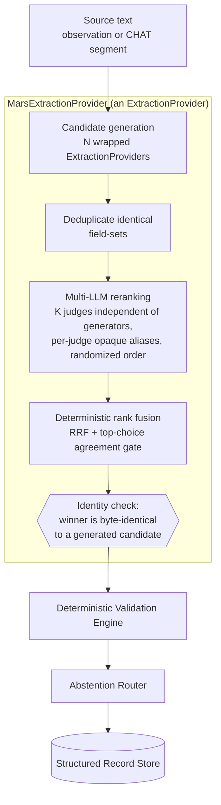

# MARS — Multi-LLM-Augmented Reranking for Structured Extraction

**Status: designed, not implemented.** Specs in [Mars_Reranking_Specs.md](./Mars_Reranking_Specs.md).

MARS raises structured-extraction accuracy by generating several candidate extractions for the same source text and using multiple LLM judges to **rank** them, rather than trusting one model's single attempt. The selected candidate is one of the generated candidates, returned verbatim; judges order candidates and never supply field values.

## Context

A pilot annotation of 31 real CHAT segments found single-model zero-shot extraction correct on 60.6% of field judgments (94/155), with a 4.5% unsupported-field rate. **This figure is superseded and is not a baseline.** It was produced while a defect in `chat_parser._match_child` left every segment's `child_id` set to `"unknown"`, which disabled the per-child balancing in `select_segments`; the resulting sample drew 28 of 31 segments from one child (Carl), 2 from Josh, 1 from Mars, and none from any Flusberg child. It describes one child's transcripts, not the corpora. No MARS result is to be compared against it — the comparator is a single-generator baseline measured on the child-stratified batch, under the same conditions as MARS itself.

Retained here because the *shape* of the pilot still motivates the design, even though its magnitudes do not survive:

| Field | Correct |
|---|---|
| behavior | 81% |
| domain | 58% |
| outcome | 55% (6/31 judgments unsupported) |
| modality | 45% |
| prompt_level | 45% |

`outcome` — the field an interventionist reads most directly as a claim about the child — was both the lowest-accuracy field and the sole locus of unsupported values. That co-occurrence is what MARS targets, and it is a claim about shape rather than magnitude, so it survives the sampling defect above. See [Analytics_Engine.md](./Analytics_Engine.md) for the downstream consumers whose inputs improve if extraction improves.

## Position in the pipeline

MARS **implements the `ExtractionProvider` protocol** and composes other providers behind it. Consuming layers — the observation orchestrator, validation, abstention, persistence, analytics, reporting, frontend — see the existing contract and require no change, which is the same substitutability property the temporary→fine-tuned provider swap depends on (see [Extraction_Provider.md](./Extraction_Provider.md)).



Two invariants hold this together:

- **Judges rank; they never author.** A judge receives candidates under per-judge opaque aliases and returns an ordering over those aliases. A judge response containing a field value is invalid and discarded — the system has no code path that reads a value from a judge.
- **Fusion is deterministic.** Aggregating rankings, breaking ties, and applying the agreement gate are arithmetic, performed in code. No LLM selects the winner; the judges' rankings are inputs to a formula.

Together these keep the HLD's guarantee intact — no LLM-originated value reaches persistence — while still letting model judgment improve which code-computed candidate is chosen.

### Execution contract

```text
PROVIDER RESPONSES
      │
      ▼  admission: drop FAILED/ABSTAINED/empty/structurally invalid; observations[0] only
      ▼  deduplicate: preserve ALL generator identities per candidate
      │
      ├── 0 candidates ──────────────► abstain  no_reviewable_candidate
      │
      ├── 1 candidate ──► integrity ─► return / abstain      (no judge roster required)
      │
      ▼  2+ candidates
      │
      ▼  eligible judges: model ∉ generator provenance of ANY candidate
      │        └── too few ─────────► abstain  insufficient_eligible_judges
      ▼  per-judge opaque aliases, derived seeds
      ▼  valid rankings
      │        └── too few ─────────► abstain  insufficient_valid_judge_responses
      ▼  RRF  →  stable-internal-ID tie-break  →  provisional winner
      │        └── not modal first choice ────► abstain  judge_disagreement
      ▼  top-choice support OF THE WINNER
      │        └── below threshold ──────────► abstain  judge_disagreement
      ▼  integrity: winner ≡ one and the same admitted candidate
      │        └── mismatch ─────────────────► abstain  integrity_failure
      ▼  control_confidence = min(generator_confidence, mars_selection_confidence)
      ▼
ExtractionResult  ──►  existing Deterministic Validation Engine (unchanged)
```

The ordering is load-bearing rather than incidental. Fusion and tie-breaking run *before* the agreement gate because the gate has to answer a question about a specific candidate — *is there sufficient agreement for the candidate we are about to return?* — and that candidate does not exist until deterministic selection has produced it. Running the gate first would measure agreement about a candidate the tie-break might not choose, and a tie-break landing on a poorly-supported candidate would then pass a gate that never examined it.

## Candidate generation

Each configured provider extracts from the same source text independently, and each response contributes **at most one** candidate, taken from `observations[0]` to match `EXTRACT-003`. MARS does not interpret additional observations; multi-observation support would change the extraction abstraction and belongs to its own design change, not to this one.

A response becomes a candidate only if it passes admission: status is neither `FAILED` nor `ABSTAINED`, `observations` is non-empty, and `observations[0]` passes structural checks. Making admission an explicit predicate is what gives the "no reviewable candidate" abstention something real to test — and it is the filter MARS's exemption from `EXTRACT-013`/`014` actually rests on.

Candidates with identical field values collapse to one entry that **retains the complete set of generator identities** that produced it, alongside a multiplicity count. Keeping the full set is a safety requirement, not bookkeeping: judge eligibility is computed against it, and a model does not become independent of a candidate merely because another model produced the same fields and the duplicate collapsed. Multiplicity is a deterministic tie-breaker later, not a score — three weak models agreeing is not evidence of correctness, and MARS does not treat it as such.

Two short-circuits precede judging:

- No provider returns a reviewable extraction → abstain. MARS adds no ability to extract from text nothing could extract from.
- Exactly one distinct candidate survives deduplication → skip *reranking*. There is no ranking question when every provider produced the same answer, and invoking judges would spend K calls to reorder a single-element list. This skips judging only: the candidate still passes output-integrity verification, and abstains if it fails. Otherwise a malformed candidate would bypass the integrity check precisely because it was the only one produced — the case with the least corroboration, not the most.

## Reranking

Each judge sees the source text and the deduplicated candidate set. Two controls apply:

- **Per-judge opaque aliases.** Each candidate holds a stable internal identifier that judges never see. Every judge receives its own alias set with no cross-judge correspondence — judge A's `K7` and judge B's `P4` may be the same candidate — so a judge can neither infer provider attribution nor a canonical position. Globally fixed labels like `C1..Cn` would leak an ordering: a judge shown `C3, C1, C2` can see it has been shuffled and can reconstruct the canonical index.
- **Per-judge randomized order.** Presentation order is independently randomized per judge. LLM rankers exhibit position bias; shuffling per judge turns a systematic bias into noise that fusion averages out.
- **Derived, not drawn, seeds.** The request seed is a hash of source identity, MARS version, admitted-candidate-set fingerprint, and a configured run seed; each judge seed derives from the request seed and that judge's model identity. Recording a randomly drawn seed only reproduces a run if the record survives; deriving it makes identical inputs reproduce identical presentations by construction. The configured run seed varies deliberately across experimental arms and stays fixed in production.

Tie-breaking uses the stable internal identifier, never a judge-visible alias — aliases are per-judge and carry no global ordering, so a tie broken on them would not be reproducible.

## Fusion and the agreement gate

Valid rankings are aggregated by **Reciprocal Rank Fusion**:

```text
score(c) = Σ_j  1 / (k + rank_j(c))         k = 60
```

RRF is chosen over score-averaging because judges produce orderings, not calibrated scores, and over simple majority-of-first-place because it uses the whole ranking rather than only its head.

### Which agreement, and why it gates

The gate uses **top-choice support of the candidate actually being returned** — the share of valid judges that ranked *that* candidate first:

```text
                     |{ j : rank_j(selected) = 1 }|
agreement(selected) = ─────────────────────────────
                            N_valid_judges
```

Measuring support for the modal first choice instead would be logically inconsistent whenever fusion selects something else: RRF uses whole rankings and can favour a broadly-acceptable second over a polarized first, so the modal first choice and the RRF winner are not guaranteed to coincide. Gating on one while returning the other would attach a passing agreement number to a candidate the number never described.

MARS therefore requires both to agree. If the fusion winner is not also the modal first choice, MARS abstains rather than reconciling them — the safety claim is that *deterministic fusion and judge first-choice consensus identify the same candidate*, which is materially stronger than "the judges agreed about something."

Full-ranking statistics such as Kendall's W answer a different question: *how similarly did judges order the entire list?* That is not what determines MARS's output. Consider three judges:

```text
Judge 1:  A > B > C > D
Judge 2:  A > C > D > B          agreement(A) = 3/3 = 1.0
Judge 3:  A > D > B > C          Kendall's W  = low
```

Every judge agrees A wins; they disagree only about the ordering of candidates none of them selected. W penalizes this heavily, and gating on W would abstain on a unanimous decision. The case that should raise suspicion is the opposite:

```text
Judge 1:  A > B > C
Judge 2:  B > A > C              agreement(winner) ≈ 0.333
Judge 3:  C > A > B
```

Here the judges do not agree on the output at all. Gating on top-choice support aligns the safety mechanism with the quantity that actually changes what MARS returns.

Kendall's W is still computed and recorded, because "judges agreed on the winner but disagreed on everything below it" is a meaningfully different regime from "judges agreed throughout" — informative for evaluation, and a signal about judge quality. It is diagnostic only and never independently causes abstention.

Below the configured threshold, MARS **abstains rather than returning the winner**. This is the design's sharpest claim, and it is deliberate: when independent judges disagree about which extraction the evidence supports, that disagreement is a measurement of evidential ambiguity in the segment. Returning the plurality choice would convert a genuine ambiguity into a confident-looking record, which is precisely the failure the *abstain over assert* tenet exists to prevent.

### What reproducibility does and does not cover

MARS guarantees **deterministic orchestration replay**, and that boundary is worth stating precisely because it is easy to overclaim:

```text
reproducible by MARS            not guaranteed by MARS
--------------------            ----------------------
admitted candidate set          a judge's ranking on re-execution
per-judge aliases               model inference determinism
presentation order
derived request/judge seeds
rank fusion and tie-breaking
gate and integrity outcomes
```

Seeds are derived rather than drawn — from source identity, MARS version, an order-independent candidate-set fingerprint, and a configured run seed — so identical inputs reproduce identical presentations by construction rather than by having retained a record. The candidate-set fingerprint is built from sorted content-derived internal ids, which makes it invariant to provider response order: concurrent generators returning in a different order must not reshuffle what judges see. It is likewise independent of generator identity and confidence, since it describes *what* is being judged rather than who produced it — provenance already governs judge eligibility separately, and letting it also move the seed would reshuffle a presentation for a candidate set that never changed.

Everything downstream of the judges is arithmetic and therefore replays exactly. The judges themselves are not, unless the serving layer makes them so. Accuracy claims about MARS must be stated over stored judge responses, or repeated with enough trials to characterize the variance — the same discipline `compare_providers_v2.py` already applies when it reports test-retest agreement rather than treating one run as definitive.

## Judge-generator independence

A model never judges a candidate set containing its own generation. LLM-as-judge systems exhibit documented self-preference — models favour their own outputs, or outputs whose surface characteristics resemble their own — so a roster where generators also judge confounds "this candidate is better supported by the evidence" with "this candidate looks like something I would produce."

```text
GENERATION                    JUDGING
Model A → candidate           Model D → ranks
Model B → candidate           Model E → ranks
Model C → candidate           Model F → ranks
```

Eligibility is evaluated against the *complete* generator provenance of *every* candidate in the set — including identities merged during deduplication. A judge is ineligible if its model appears anywhere in that union. The narrow reading, excluding a judge only from candidates nominally attributed to it, opens the loophole precisely where it matters most: identical output is likeliest between similar models, so collapsing a duplicate would silently restore self-judging in exactly the cases where self-preference is most probable.

Opaque aliases already prevent a judge from *seeing* which model produced a candidate; independence additionally prevents a judge from recognizing its own output by its style. The two controls address different mechanisms and neither substitutes for the other.

The prohibition is on **exact model overlap**. Same-family overlap (say, two different sizes of one base model) is permitted, recorded, and analyzed rather than forbidden — family-level bias is plausible but less established than exact self-preference, and prohibiting it would make the roster infeasible to satisfy from locally available models, which is a real constraint on running the experiment at all. Recording the family keeps the question empirically open instead of assumed away.

This creates a roster feasibility edge: once self-judging is prohibited, a roster of three generators and the same three models as judges yields no eligible judges. MARS abstains in that case rather than silently relaxing the constraint, and it needs no new abstention cause to do so — insufficient eligible judges is the same condition as insufficient valid judge responses.

## Confidence semantics

MARS carries two confidence quantities that must not collapse into one another:

- **`generator_confidence`** — reported by the provider that produced the selected candidate. It describes that model's confidence in its own extraction.
- **`mars_selection_confidence`** — derived solely from the judge rankings, their fused scores, and inter-judge agreement. It describes confidence in the *selection*, not in the extraction.

They are independent, and each catches a failure the other misses:

```text
generator_confidence      = 0.32     judges unanimous:  A > B > C  (×3)
mars_selection_confidence = 0.95     → MARS is sure A is the best candidate available,
                                       and A may still be a poor extraction.

generator_confidence      = 0.96     judges split 50/50
mars_selection_confidence = low      → both candidates look individually strong,
                                       and MARS has weak evidence about which to return.
```

Neither quantity alone is safe to hand to deterministic validation. So the contract carries a third:

### `control_confidence`

`control_confidence` is the single quantity deterministic validation gates on, for **every** provider (`EXTRACT-020`). It is not a MARS concept — it is a contract concept that MARS computes differently:

```text
ordinary generating provider   control_confidence = generator_confidence
MARS                           control_confidence = min(generator_confidence,
                                                        mars_selection_confidence)
```

The safety reading of the minimum: *a returned observation is only as trustworthy as its weakest relevant confidence dimension.* Either failure mode above drags `control_confidence` down, and neither can hide behind the other.

This keeps `VALID-011` (`< 0.4` → interventionist review) and `VALID-013` (`< 0.7` → retain-with-unknown) meaning the same thing across providers — *confidence in the returned observation reaching deterministic control* — instead of silently meaning "model self-confidence" for one provider and "judge agreement" for another. That is why the validation specs are amended rather than reinterpreted: a threshold whose meaning varies by provider is not a deterministic gate.

The minimum is a starting rule, not a finding. If calibration shows it too conservative, the combination function can be replaced without touching the contract, because consumers depend on `control_confidence` and not on how it was derived.

This also settles how MARS relates to the single-provider status rules in [Extraction_Provider_Specs.md](./Extraction_Provider_Specs.md). `EXTRACT-013` (confidence below 0.3 → abstain) and `EXTRACT-014` (five or more null fields → abstain) govern a *generating* provider's own result. MARS applies them through its admission predicate; re-applying them to the selected candidate would gate the ensemble on a quantity describing one generator. MARS's status comes from the MARS gates alone.

## Abstention shape

MARS has five abstention causes — no reviewable candidate, too few *eligible* judges, too few *valid* judge responses, judge disagreement (either the fusion winner is not the modal first choice, or its support is below threshold), and integrity failure. All emit **one canonical result shape** with a machine-readable `reason_code`, rather than each inventing its own format:

```text
status              = ABSTAINED
reason_code         = no_reviewable_candidate
                    | insufficient_eligible_judges
                    | insufficient_valid_judge_responses
                    | judge_disagreement
                    | integrity_failure
candidate_count     = <int>
generator_ids       = [...]
judge_ids           = [...]      // empty when judging never occurred
ranking             = [...]      // empty when judging never occurred
selected_candidate  = null
provenance          = { ... }
```

"Every abstention carries provenance" does not mean "every abstention carries judge provenance." Provenance describes the execution that actually occurred: an abstention raised before any judge was invoked carries empty `judge_ids` and `ranking`, and that is a complete record rather than a partial one. Distinguishing the causes downstream is a `reason_code` comparison, not prose parsing — they have entirely different remedies, and their relative frequency is itself an evaluation result. The eligible/valid split matters most here: too few eligible judges is a **roster or configuration** problem fixed before the run, while too few valid responses is an **execution** problem in model output. Collapsing them into one code would hide which of those is happening.

## Provenance

Every MARS result records the contributing providers, the judges, each judge's ranking, the fused scores, the agreement statistics, the derived seeds, and both underlying confidence quantities. Extraction becomes a multi-model process whose output is a *selection*; without the rankings that produced it, a selection is unauditable and an accuracy figure over MARS output is unreproducible.

Provenance lives in the **shared `ExtractionResult` envelope** (`EXTRACT-021`), not in a MARS-specific side channel. A side channel would reintroduce exactly the asymmetry substitutability exists to prevent — every provider returning `ExtractionResult`, except one that also returns hidden state its consumers must know to look for. Evolving the envelope additively keeps `EXTRACT-002` satisfied: the shape is identical across providers, and optional fields differ in *applicability*, not presence. A single-model provider populates it with empty `judge_ids` and an empty `ranking`, which is an accurate statement that judging did not occur rather than filler.

Provenance does not go onto `StructuredObservation`. That model describes the observation — what the child did — not how the record was derived; mixing derivation metadata into it would put ensemble bookkeeping into the clinical record.

## Evaluation objectives

Two objectives are load-bearing for any claim MARS makes, and neither is an ordinary accuracy number.

### Agreement threshold selection

The threshold governing the abstention gate is **derived, not chosen**. Picking a round number heuristically ("abstain when disagreement exceeds 0.30") makes the coverage/precision trade-off an arbitrary parameter and leaves any resulting abstention rate uninterpretable.

**A numerical equivalence between human κ and judge top-choice concordance is not available and must not be claimed.** The two measure different tasks. Human annotators judge fields against raw source text:

```text
raw segment  →  annotated extraction fields
```

Judges rank a supplied candidate set:

```text
candidates A/B/C  →  ranking
```

A human κ of 0.82 therefore does not license a judge-agreement threshold of 0.82; the numbers are not on a common scale, and asserting otherwise would be indefensible in review. The claim this design supports is the weaker, accurate one: **threshold selection is informed by human disagreement observed on the annotated batch and validated against the resulting accuracy/abstention trade-off.** Human IAA is an empirical anchor for *where* genuine evidential ambiguity lives in the corpus, not a value to transplant.

The stronger experiment, if the annotation budget allows a second pass, has human annotators rank the same blinded candidate sets the judges see:

```text
human candidate-selection agreement  →  empirical distribution  →  judge-agreement calibration
```

That makes the two quantities the same measurement on the same task, and only then does direct calibration become defensible. Whether to run it is an open decision, not an assumption baked into the design. The batch's full double annotation (`--overlap 1.0`) is what makes either route measurable.

### Oracle candidate ceiling and capture rate

MARS selects among generated candidates and can never select a correct answer none of its generators produced. That imposes a hard ceiling, and reporting accuracy without it conflates two distinct problems. Evaluation therefore reports three quantities:

```text
Single best generator      75%     ← the honest comparator
MARS                       82%     ← what reranking achieved
Oracle candidate ceiling   88%     ← at least one candidate correct
```

The ceiling is measurable from the same annotated batch: the fraction of segments on which *any* generator produced a fully correct extraction. From these,

```text
                      MARS accuracy − best-generator accuracy       82 − 75
Oracle capture rate = ────────────────────────────────────────  =  ───────  =  53.8%
                      oracle accuracy − best-generator accuracy     88 − 75
```

Capture rate answers the question accuracy alone cannot: of the improvement reranking could theoretically deliver, how much did it actually capture? A system reporting only "75% → 82%" hides whether it left 6 points on the table or nearly none. Separating the two also directs the next iteration correctly — a low capture rate is a *reranking* problem (better judges, better fusion), while a low ceiling is a *generation* problem (more or more diverse generators), and the two have entirely different fixes.

Abstention makes both figures conditional: accuracy is computed over returned records, so it must always be reported alongside the abstention rate and its `reason_code` breakdown. A system that abstains on everything hard has a flattering accuracy and no utility.

### Judge-independence ablation

Independence is a design constraint, so its cost and benefit should be measured rather than asserted:

| Configuration | Accuracy | Abstention | Self-overlap |
|---|---|---|---|
| Independent judges (primary) | — | — | 0% |
| Self-judging allowed | — | — | >0% |
| Single generator (baseline) | — | — | n/a |
| Oracle candidate ceiling | — | — | n/a |

The reading of this table is not symmetric, and that asymmetry is the point. If self-judging scores *higher*, that is not automatically a legitimate improvement — self-preference produces exactly that signature, and the gain cannot be distinguished from bias without further evidence. If performance is essentially unchanged, the result is a robustness finding worth reporting: the independence constraint costs nothing, so the safer configuration is free.

## Decisions & Alternatives

| Decision | Chosen | Alternatives Considered | Rationale |
|---|---|---|---|
| MARS's own interface | Implements `ExtractionProvider`, composing other providers | A new orchestration layer above the provider, called by the observation orchestrator | Composing behind the existing protocol means zero changes to APIs, persistence, validation, abstention, analytics, reporting, or frontend — the same substitutability the fine-tuned-model swap requires. A new layer would put multi-model logic into business code, which the safety rules forbid |
| What judges emit | An ordering over opaque candidate labels | Judges emit a corrected extraction; judges emit per-field confidence scores | A judge that emits a value is an extractor, and its output would be an LLM-authored field reaching persistence. Restricting judges to orderings makes "no LLM-originated value" checkable by construction rather than by prompt discipline |
| Winner selection | Deterministic RRF over judge rankings | An LLM aggregator reading all judge outputs and picking a winner | An LLM aggregator would be an unauditable, non-reproducible selection step, and it re-opens the value-authorship hole that opaque aliases close |
| Judge disagreement | Abstain | Return the plurality winner with a lowered confidence score | A caveated record still reads as a conclusion — the same reasoning the HLD applies to analytics abstention. Disagreement among independent judges is the signal that the segment does not determine an answer |
| Reranking unit | Whole extraction record | Per-field reranking, assembling a best-of record from each field's winner | Per-field selection can assemble a record no provider proposed and no judge endorsed — e.g. `prompt_level=independent` from one candidate with `modality=verbal_prompt` from another — which is internally inconsistent and would be rejected by the Validation Engine's cross-field rules anyway. Whole-record selection preserves the internal coherence of a single model's reading. Revisit under Open Question 2 |
| Deterministic validation gates on a new contract-level `control_confidence`, not on either MARS confidence directly | `control_confidence = min(generator_confidence, mars_selection_confidence)`; both preserved in provenance | Write `mars_selection_confidence` into the existing `confidence` field; write `generator_confidence`; average the two | The two quantities catch different failures — a confidently-extracted poor candidate, and a weakly-distinguished pair of strong candidates — and either alone leaves one uncaught. Overloading the existing field would also make `VALID-011`/`013` mean "model self-confidence" for one provider and "judge agreement" for another; a threshold whose meaning varies by provider is not a deterministic gate. The minimum is replaceable without a contract change |
| Provenance evolves the shared `ExtractionResult` envelope | Optional provenance and `reason_code` on the shared result | A MARS-owned side channel; provenance fields on `StructuredObservation` | A side channel recreates the asymmetry substitutability exists to prevent — every provider returns `ExtractionResult`, except one that also returns hidden state. Optional fields keep the shape identical (satisfying `EXTRACT-002`); empty `judge_ids` on a single-model provider accurately states that judging did not occur. `StructuredObservation` describes the observation, not its derivation |
| One provider response contributes at most one candidate, from `observations[0]` | Align with `EXTRACT-003` | Let MARS interpret multi-observation responses as multiple candidates | Consuming additional observations would silently change the extraction abstraction for MARS only. If multi-observation support is wanted, it is its own design change across the segment, not a side effect of adding reranking |
| Fusion and tie-breaking run before the agreement gate, and the fusion winner must also be the modal first choice | Ordered pipeline; abstain when the two disagree | Gate on agreement first, then fuse; return the fusion winner regardless of the modal first choice | The gate answers "is there enough agreement for the candidate we are about to return?", which cannot be evaluated before deterministic selection produces one. Returning a fusion winner that no plurality of judges ranked first would attach a passing agreement figure to a candidate it never described |
| Eligible-judge and valid-response shortfalls carry distinct reason codes | `insufficient_eligible_judges` and `insufficient_valid_judge_responses` | One shared code with a `failure_stage` discriminator; one code only | The enumeration exists to make causes machine-separable, and these two have different remedies — roster/configuration versus model execution. A discriminator field inside one code reintroduces the parsing step the enumeration removed |
| Abstention gates on top-choice concordance, not full-ranking agreement | Top-choice concordance gates; Kendall's W recorded as a diagnostic | Kendall's W or mean pairwise Kendall's τ as the gate | W and τ measure agreement over the whole ordering, including candidates no judge selected. Judges unanimous on the winner but scattered below it would abstain under W despite a unanimous decision — the gate must track the quantity that determines the output, which is the head of the ranking |
| A model never judges a candidate set containing its own generation | Exact model overlap prohibited; provenance hidden from judges | Allow self-judging and correct for it statistically; prohibit same-family overlap too | Documented LLM self-preference would confound "better supported by the evidence" with "resembles my own output." Prohibiting same-family overlap as well would make the roster infeasible from locally available models, so family is recorded and analyzed instead — keeping the weaker bias an open empirical question rather than an assumed one |
| Generator confidence and selection confidence are separate quantities | `generator_confidence` and `mars_selection_confidence` recorded distinctly; the latter derived only from judge rankings and agreement | Propagate the winning candidate's confidence as MARS's confidence; average candidate confidences | A candidate can carry 0.95 generator confidence while judges disagree sharply about it. Propagating the generator's number would launder one model's self-assessment into an ensemble-level claim, and would let a confident-but-contested extraction present as a confident MARS result |
| MARS's `ExtractionResult.status` derives from MARS gates only | The MARS gates alone determine status | Re-apply `EXTRACT-013`/`EXTRACT-014` thresholds to the selected candidate | Those rules scope to a *generating* provider's own result, and MARS has already applied them through its admission predicate. Re-applying them would gate the ensemble on a quantity describing one generator |
| Every abstention gate emits one canonical result shape with a `reason_code` | Single shape; `judge_ids`/`ranking` empty where judging did not occur | Let each gate return its own natural shape; distinguish causes by the abstention message | The causes have different remedies and their relative frequency is itself a result; separating them by prose parsing is fragile. Provenance describes the execution that occurred, so an empty judge list is a complete record, not a partial one |
| Agreeing candidates | Multiplicity used only as a deterministic tie-break | Weight fused scores by how many providers produced a candidate | Correlated models agreeing is a measure of shared training distribution, not of correctness; weighting by it would systematically favor whichever model family is over-represented in the ensemble |
| Presentation order | Shuffled per judge from a recorded seed | Fixed order for all judges | A fixed order lets every judge's position bias push in the same direction, which fusion would then amplify rather than cancel |

### Superseded decisions

Recorded so the evolution is legible; these are **not** active design.

| Rejected | Reason rejected | Superseded by |
|---|---|---|
| Use one `insufficient_valid_judges` reason code for both roster insufficiency and invalid judge responses | The two failures occur at different stages and require different remediation — a roster/configuration fix before the run versus a model-execution problem during it. Combining them would require a secondary discriminator or prose parsing, undermining the machine-separable reason-code design the enumeration exists to provide | `insufficient_eligible_judges` (MARS-028) and `insufficient_valid_judge_responses` (MARS-011) |

## Open Questions & Future Decisions

1. **Agreement threshold value.** The selection procedure is settled (informed by human disagreement on the annotated batch, validated against the accuracy/abstention trade-off — see Evaluation objectives); the resulting number is not, because the batch has not been annotated yet. Until it is set from data, no MARS accuracy figure is comparable across runs.
2. **Per-field reranking.** The pilot's field spread (behavior 81% vs. prompt_level 45%) suggests per-field selection has more headroom than whole-record. Deferred over the internal-consistency objection above; revisiting requires deciding whether the Validation Engine's cross-field rules are sufficient to catch incoherent assemblies.
3. **Judge count and vendor spread.** How many judges, and whether they must span vendors. Judge-generator independence is settled (MARS-027), but the roster size satisfying it is not, and routing transcript text to third-party APIs is a governance question, not only a cost one.
4. **Whether to run the second human pass** in which annotators rank the same blinded candidate sets the judges see. It is the only route to a defensible numerical calibration between human and judge agreement; without it, threshold selection stays informed-and-validated rather than directly calibrated.
5. **Cost.** MARS makes N + K model calls per extraction against a single-model baseline's one. Whether that is acceptable in production, or MARS is a research/batch configuration with a cheaper production path, is undecided.

## References

- `docs/High_Level_Design.md` — the "never asserted by an LLM" guarantee this design is built to preserve, and the *abstain over assert* tenet the agreement gate applies.
- [Extraction_Provider.md](./Extraction_Provider.md) — the protocol MARS implements and composes.
- [Deterministic_Validation_Engine.md](./Deterministic_Validation_Engine.md) — downstream validation MARS output passes through unchanged; owner of the cross-field rules cited in Open Question 2.
- [Abstention_Router.md](./Abstention_Router.md) — per-observation abstention, distinct from MARS's internal judge-disagreement abstention.
- `CLAUDE_PROJECT_HANDOFF.md` §13 (Extraction Experiments), §23 ("Never use synthetic/LLM-generated labels as unquestioned ground truth").
- `tests/eval/extraction/build_annotation_batch.py` — child-stratified, double-annotation batch builder producing the labels any MARS evaluation requires.
- [Mars_Reranking_Specs.md](./Mars_Reranking_Specs.md) — EARS specs (`MARS` prefix).
